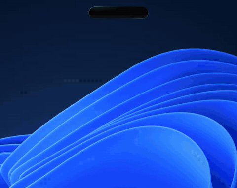

# HALO

**A Dynamic Island for Windows.** Free.

Your music, browser media, messenger notifications and a timer – in a pill at the top of your screen.

[**⬇ Download for Windows**](https://github.com/ecch1369/halo/releases/latest/download/HALO-Setup.exe) ·
[Download page](https://ecch1369.github.io/halo/) ·
[Report a bug](https://github.com/ecch1369/halo/issues) ·
[Support ♥](https://reymit.ir/hworks)

<!-- Put a 10-20 s demo GIF here:   -->

---

## Features
- **Looks like nothing until it matters.** A black pill at the top of the screen; with nothing playing it is pure black and empty.
- **Works with any player.** Shows what's playing in any browser or app (YouTube, Spotify, podcasts…) with cover art, progress and working play / pause / next / previous / seek. It reads the same Windows media controls as the volume flyout.
- **Local music.** Drag & drop files onto the pill; your playlist is saved between runs.
- **Colours follow the cover art**, with a soft glow and a black "liquid glass" look.
- **Notifications.** Messages from Telegram, WhatsApp, X, Bale, Rubika, Instagram, Discord… pop out as a banner.
- **Timer**, power button, starts with Windows, global shortcut **Win+Alt+H** (changeable from the tray menu).
- **Stays out of your way.** Click-through everywhere except the island itself, so it never blocks the UI under it (After Effects, Photoshop…). Auto-hide after idle time (tray → *Auto-hide when idle*).
- **Updates itself.** Tray icon → *Check for updates*.

## Install
1. Download **[HALO-Setup.exe](https://github.com/ecch1369/halo/releases/latest/download/HALO-Setup.exe)**.
2. Run it – one click, one admin prompt (needed once to register the notification helper with Windows).

Requires Windows 10 (2004+) or Windows 11.

### "Windows protected your PC"?
The installer isn't code-signed yet, so SmartScreen may warn you. Click **More info → Run anyway**.
The complete source code is in this repository and you can scan the installer on [VirusTotal](https://www.virustotal.com/) first.

## Privacy
HALO asks once before reading anything. It only looks at notifications from messenger/social apps; everything else is ignored immediately.
Message text is never saved to disk or sent anywhere – nothing leaves your PC. You can turn it off any time: tray icon → *Show messenger notifications*.

## Troubleshooting
- Logs (without message text) are in `%LOCALAPPDATA%\HALO\logs\halo.log` – attach that file when you open an issue.
- Notifications stopped working? Tray icon → *Fix notifications (re-run setup)*, and check Windows Settings → Privacy & security → Notifications allows apps to read notifications.

## Build from source (Windows)
1. Install Node.js LTS.
2. Double-click `build.bat` → the installer is created in `dist\`.

## Support
HALO stays completely free. If you like it, you can support the project: https://reymit.ir/hworks – and a ⭐ on this repo helps a lot.

Made by **hworks** · ecchworks@gmail.com

Copyright (c) hworks. All rights reserved.

---

## HALO به فارسی

**HALO یک «دایناميک آیلند» برای ویندوز است – کاملاً رایگان.** موزیک، کنترل مدیای مرورگر، نوتیفیکیشن پیام‌رسان‌ها و تایمر، همه در یک قرص مشکی بالای صفحه.

- هر چیزی که در مرورگر یا برنامه‌ای پخش شود (یوتیوب، اسپاتیفای، پادکست…) با کاور و کنترل کامل نمایش داده می‌شود.
- نوتیف تلگرام، واتساپ، بله، روبیکا، اینستاگرام، دیسکورد و … به شکل بنر ظاهر می‌شود.
- رنگ‌ها از روی کاور آهنگ تغییر می‌کنند؛ وقتی کاری نباشد خودش محو می‌شود و جلوی برنامه‌های شما را نمی‌گیرد.
- **حریم خصوصی:** متن پیام‌ها هرگز ذخیره یا ارسال نمی‌شود و قبل از هر کاری از شما اجازه می‌گیرد.

**نصب:** فایل [HALO-Setup.exe](https://github.com/ecch1369/halo/releases/latest/download/HALO-Setup.exe) را دانلود و اجرا کنید. اگر ویندوز پیام «Windows protected your PC» داد، روی **More info** و بعد **Run anyway** بزنید (هنوز امضای دیجیتال ندارد؛ کد کامل برنامه همین‌جا باز است).

**حمایت:** استفاده از HALO رایگان می‌ماند. برای حمایت: https://reymit.ir/hworks

